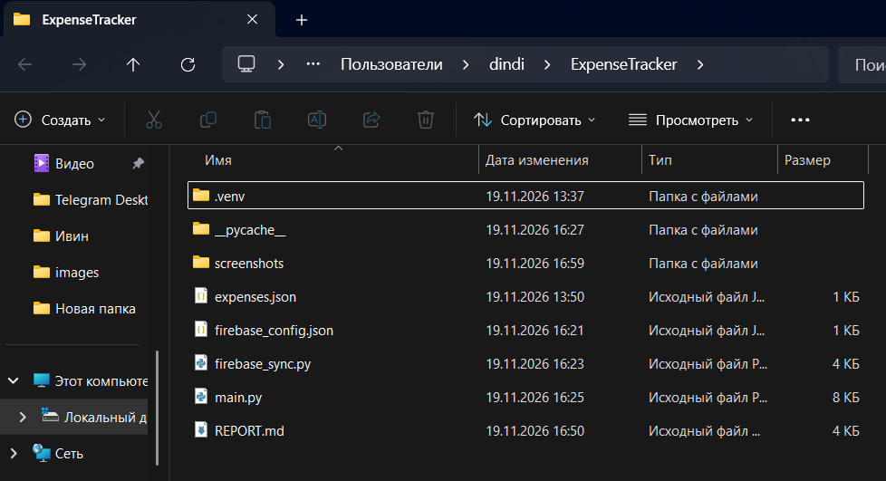
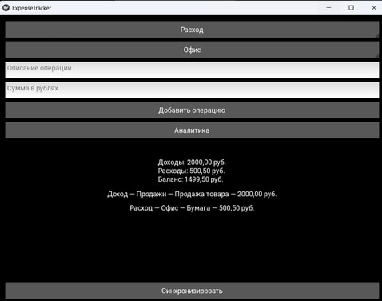
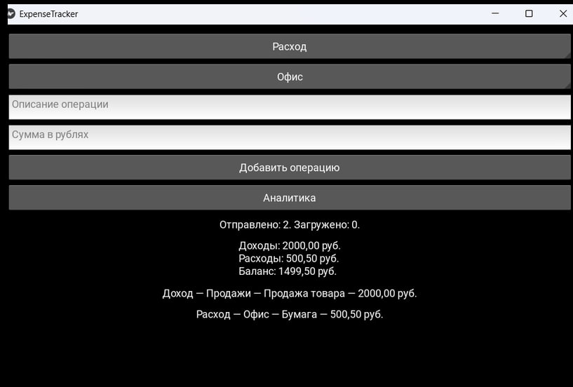
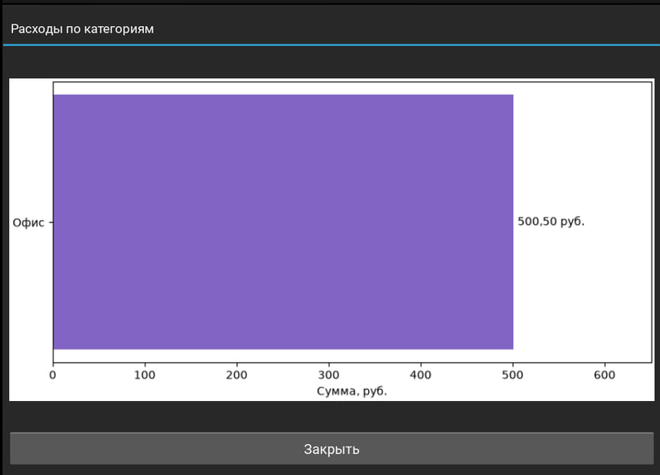
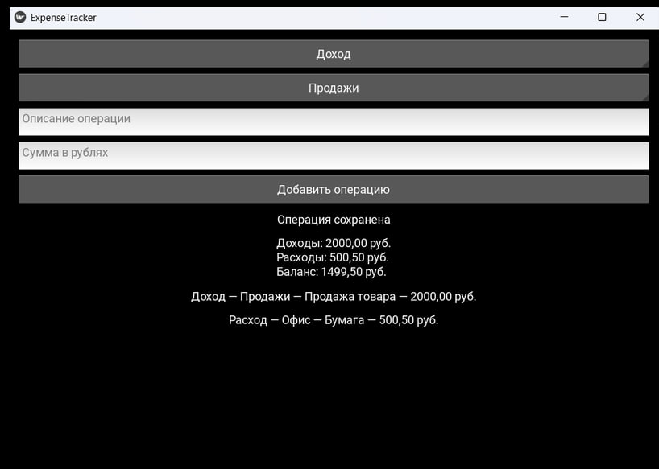

# Разработка приложения ExpenseTracker

## Цель работы

Разработать на Python и Kivy приложение для учёта доходов и расходов, расчёта баланса, визуализации расходов и синхронизации операций с Firebase.

## 1. Структура проекта

В файле `main.py` реализованы интерфейс, учёт операций и построение графика. Модуль `firebase_sync.py` отвечает за вход и синхронизацию. Операции сохраняются локально в `expenses.json`.

*Рисунок 1 — Структура проекта ExpenseTracker*

## 2. Интерфейс и учёт операций

В главном окне пользователь выбирает тип и категорию операции, вводит описание и сумму. После сохранения приложение обновляет историю и пересчитывает баланс.

*Рисунок 2 — Главное окно приложения*

Для проверки работы приложения внесено пять операций: два дохода от продаж и три расхода по категориям «Офис» и «Маркетинг». Общая сумма доходов составила 5 000,00 руб., расходов — 3 000,50 руб. Итоговый баланс составил 1 999,50 руб.

*Рисунок 3 — История операций и расчёт баланса*

## 3. Аналитика расходов

По кнопке «Аналитика» открывается горизонтальная столбчатая диаграмма расходов по категориям. Matplotlib строит диаграмму, а Kivy отображает её в окне приложения. Расходы по категории «Офис» составили 2 000,50 руб. (66,7% общей суммы), по категории «Маркетинг» — 1 000,00 руб. (33,3%). Офисные расходы примерно вдвое выше расходов на маркетинг.

*Рисунок 4 — Расходы по категориям*

## 4. Облачная синхронизация

После входа по электронной почте и паролю приложение обменивается операциями с Firebase Realtime Database через REST API. При первой проверке приложение отправило две локальные операции.

*Рисунок 5 — Результат первой синхронизации*

*Рисунок 6 — Настройка способа входа в Firebase*

На вкладке «Данные» в Firebase появились обе операции. Суммы хранятся в копейках, поэтому доходу соответствует значение `200000`, а расходу — `50050`.

*Рисунок 7 — Операции, сохранённые в Firebase Realtime Database*

## Вывод

Разработано приложение для учёта доходов и расходов с расчётом баланса, визуализацией расходов по категориям и облачной синхронизацией. На пяти тестовых операциях проверен расчёт баланса и построена диаграмма расходов по двум категориям. При первой проверке синхронизации подтверждена отправка двух операций в Firebase.
